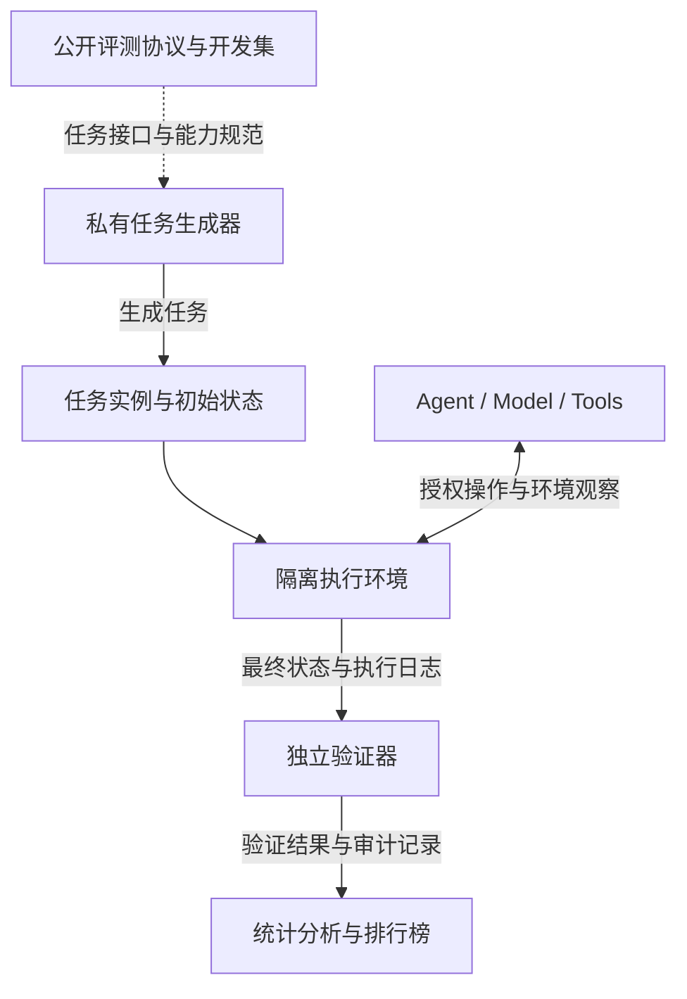

Agent Benchmark 的可信度，不只取决于任务是否足够困难，还取决于模型有没有机会提前见到答案，以及评测系统能否确认它确实完成了任务。对 Browser Agent、Computer Use Agent（CUA）和 Coding Agent 而言，这个问题尤其复杂：Agent 可以主动搜索网页、读取文件、调用 API、修改环境状态，甚至在评测期间接触到评测器意外暴露的信息。

一个值得长期维护的 Benchmark 应该遵循这样的设计原则：**公开能力定义、任务接口和评测协议；保留独立的私有测试任务及校验信息；在隔离环境中执行 Agent；利用可信的最终状态验证器评分；通过持续更新和受限反馈减轻过拟合。**

这并不意味着所有内容都必须保密。恰恰相反，评测协议越透明，外部研究者越容易判断分数的含义。需要控制的是那些会让模型绕过目标能力、直接取得答案的信息。

## 一、先建立威胁模型

讨论“数据泄露”前，必须确定泄露发生在什么阶段、攻击者能控制什么，以及评测到底想测量什么。至少要区分以下四类风险。

| 风险 | 典型场景 | 主要问题 |
| --- | --- | --- |
| 训练数据污染（Training Contamination） | 测试题、参考轨迹或标准答案进入模型训练语料 | 高分可能来自记忆而非泛化 |
| 运行时答案泄露（Runtime Solution Leakage） | Agent 上网搜索题解、读取代码仓库或找到隐藏数据 | Agent 在执行中绕过任务 |
| 评测系统泄露（Harness Leakage） | Ground Truth、验证脚本、内部接口或密钥暴露给 Agent | 评测边界失效 |
| 排行榜过拟合（Leaderboard Overfitting） | 开发者根据大量重复提交的反馈调参 | 私有测试集逐渐变成开发集 |

这四种风险不能靠同一个措施解决。隐藏测试题主要缓解训练污染和直接抄答案，却不能阻止运行时网络访问泄露，也不能消除反复提交带来的过拟合。

此外，**答案泄露与正常工具使用之间没有天然边界**。一个 Research Agent 的任务可能本来就需要搜索网络；一个 Coding Agent 需要阅读仓库历史；一个 Browser Agent 需要操作动态网页。因此，不能仅凭“调用了搜索工具”就认定作弊。评测组织者应明确允许访问的数据范围，以及哪些内容属于受保护的评测工件。

## 二、隔离任务生成、执行和评分

一个可实施的 CUA Benchmark 可以划分为四个逻辑层：



*图：Agent Benchmark 的任务生成、执行和评分流程。Agent 与评测器具有不同的访问权限。*

私有任务生成器负责确定目标和初始化环境；Agent 只获得完成任务所需要的用户指令及授权界面；独立验证器在执行结束后检查真实状态；排行榜服务只处理汇总后的结果。

关键不是把所有信息都塞进一个 JSON，然后指望模型不读取隐藏字段，而是**在权限与部署上区分 Agent 可见数据和验证器私有数据**。

例如，一项电商后台任务可以表示为：

```json
{
  "task_id": "order-001",
  "instruction": "将订单 #58321 的配送方式修改为顺丰速运",
  "initial_state": {
    "order_id": 58321,
    "shipping": "standard"
  },
  "expected_state": {
    "order_id": 58321,
    "shipping": "sf_express"
  }
}
```

这里的完整对象仅用于解释任务结构。在实际系统中，Agent 应通过授权界面接收 `instruction` 并观察业务数据；`expected_state`、校验器代码以及内部数据库凭据必须留在可信评测服务中。若这些信息被挂载进 Agent 可读容器，即使提示词写着“禁止查看”，也无法构成可靠隔离。

具体实现时，可以使用独立容器或虚拟机、只读基础镜像、最小权限的工具账号和独立的验证服务。浏览器/CDP、文件系统、数据库和网络代理都应配置访问边界。对于允许联网的评测，需要记录请求并定义允许的外部资源；对于使用第三方模型 API 的方案，还需要明确任务数据会发送到哪些服务、是否会被留存。

## 三、动态任务生成：让答案无法被简单记住

固定测试集一旦公开，就可能进入模型训练数据；即便不公开，也可能随着第三方复现、日志分享和排行榜讨论逐渐泄露。动态任务生成可以减轻这一问题。

一种基本方式是将任务分为 **Task Template** 与 **Task Instance**。模板表达要测试的能力，实例提供每次运行所需的具体数据。

例如，任务模板要求：

> 找到满足多个条件的订单，修改配送方式，并确认其他订单信息不变。

生成器可以在不同实例中改变订单编号、金额、筛选条件、配送方式、数据库初始状态以及页面布局。模型即使见过类似任务，也必须在当前环境中识别目标对象。

但随机替换订单号并不足够。如果所有任务都遵循“点击第一个菜单—输入条件—保存”的固定流程，Agent 仍可能通过模板记忆取得高分。更可靠的方案要在多个层次上变化：

1. **数据层**：对象标识、记录数量、权限、排序、冲突记录和无关干扰项。
2. **交互层**：分页、弹窗、异步加载、菜单布局和可替代操作路径。
3. **工作流层**：查询、比较、更新、跨应用传递信息及异常恢复的组合。
4. **能力层**：保留从未公开的任务模板和网站类型，用于衡量跨任务泛化。

随机化也有代价。任务可能意外变得不可解，或不同随机种子导致难度差异过大。因此，生成每个实例后，应先运行可解性检查、约束检查，并对生成参数与任务难度分布进行校准。

动态评测的相关思路可以参考 [SWE-bench-Live](https://swe-bench-live.github.io/) 与 [LiveBench 论文](https://arxiv.org/abs/2406.19314)：它们通过持续引入较新的任务或问题，降低长期使用静态题库的污染风险。二者并不能保证绝对无污染，但提供了持续维护的实践方向。

## 四、验证最终状态，而不是相信 Agent 的回答

CUA 最需要避免的评分错误，是把“Agent 声称任务完成”当作“任务实际完成”。

假设用户要求修改订单配送方式。Agent 输出“已经修改成功”，并不意味着后台数据库中的字段真的发生了变化。即使 Agent 点击了保存按钮，也可能因为权限不足、网络故障或表单错误而失败。

因此，能够程序化验证的任务，应优先采用 **State-based Evaluation**，检查执行结束后的环境状态是否满足目标约束。

例如：

```python
def verify(before, after, target_id):
    target = after.orders[target_id]
    if target.shipping != "sf_express":
        return False
    if target.amount != before.orders[target_id].amount:
        return False
    if any(
        after.orders[k] != before.orders[k]
        for k in before.orders if k != target_id
    ):
        return False
    return True
```

这一示例同时检查目标字段和非目标字段，避免 Agent 通过大范围修改碰巧满足目标条件。真实系统还应考虑合法的副作用，例如审计日志和自动更新时间戳，不能简单要求整个数据库逐字节一致。

[τ-bench](https://arxiv.org/abs/2406.12045) 使用执行后的数据库状态与目标状态比较评估工具型 Agent，并提出多次运行的 `pass^k` 可靠性指标，值得参考。

并不是所有任务都能用数据库字段表达。信息检索、视觉编辑和复杂办公任务可能需要文件内容检查、页面状态断言、外部服务回执或人工复核。可以采用“确定性验证优先，模型辅助判断其次，争议案例人工审查”的分层评估方式。若使用 LLM Judge，应单独报告其一致性、误判率和人工校验结果。

更重要的是，**验证器本身也是攻击面**。Agent 不能读取或修改验证规则，验证服务也不应信任 Agent 提交的“执行成功”标记。验证规则应经过成功、失败、边界和对抗性案例测试。

## 五、私有测试集仍然会被排行榜反馈污染

把最终测试集设为 Private，只解决了一部分问题。如果开发者可以每天提交几十次，持续获得详细逐题反馈，就能逐渐针对测试集调参。即使从未见过测试样本原文，开发过程也可能对该集合发生适应。

这属于经典的自适应数据分析问题。[The Ladder](https://proceedings.mlr.press/v37/blum15.html) 研究了机器学习竞赛中因反复查询保留集而产生的排行榜过拟合问题。

建议采用三级评测制度：

| 层级 | 数据可见性 | 反馈策略 | 主要用途 |
| --- | --- | --- | --- |
| Development Set | 任务、环境和参考实现公开 | 完整轨迹与详细失败原因 | 工程调试 |
| Validation Set | 任务私有，规则公开 | 受限分项指标与诊断 | 算法选择 |
| Final Test Set | 任务实例、种子和答案私有 | 低频提交，仅聚合结果 | 正式排名 |

正式测试集应限制提交频率，并保留独立的最终报告集。对于已经公开得分的旧版本，可以继续支持历史复现，但新模型的正式排名应使用明确版本化、定期刷新的任务集。

发布排行榜时，还应记录模型版本、Agent Harness 版本、工具权限、浏览器与操作系统版本、最大步骤数、时间限制、Token 预算及外部 API 使用情况。否则，数字接近的两个成功率可能来自完全不同的实验条件。

## 六、审计与溯源：发现运行时泄露

防护之外，还需要能够调查异常分数。建议保存结构化评测轨迹，包括：

- 模型请求、工具调用、工具返回值和关键环境状态变更；
- Agent 访问的文件路径、URL、接口以及受控网络代理日志；
- 任务模板版本、实例种子、环境镜像摘要和验证器版本；
- 模型、提示词、Harness 配置、执行预算与最终验证结果。

这些日志本身也可能包含敏感数据或隐藏任务信息，必须限制访问、设置留存周期并进行必要脱敏。公开用于复现的轨迹，需要与私有审计原始记录分开管理。

可以进一步设计 **Canary**：在 Agent 正常任务路径之外放置独一无二的标识，检查其是否出现在工具访问记录或最终输出中。发现标识意味着存在值得调查的访问路径；没有发现则不能证明不存在泄露，尤其不能证明模型训练阶段完全无污染。

还应区分三种结论：检测到可疑行为、确认存在越权信息访问、证明该访问影响了最终成绩。三者所需证据不同，不能仅靠高分或异常访问记录就直接认定作弊。

## 七、如何同时保证可信度和可复现性

私有评测可以减少泄露，却使外部研究者更难审计。解决这一矛盾的方式不是二选一，而是分层公开：

**应该公开**：能力定义、任务分布、生成算法的公开部分、环境接口、开发集、验证器设计原则、评分指标、统计方法和版本变更日志。

**应该保护**：正式测试实例、私有任务模板、随机种子、目标状态、测试专用凭据及能够反推答案的详细反馈。

对于需要独立核验的论文或排行榜，可以由可信第三方重复运行评测，或在测试集退役后公开经过审查的样本和轨迹。完整复现还应固定环境镜像与依赖版本；真实在线网站的状态随时间变化，必须额外记录网站版本或采用可重置的自托管环境。

统计上，推荐同时报告整体 Task Success Rate、不同任务类别的成功率、重复运行可靠性、时间和成本。比较两个 Agent 时，应尽可能使用相同的任务实例、成对随机种子与一致的预算；对于成功率差异，给出置信区间或其他不确定性估计。

## 八、一个可落地的 CUA Benchmark 方案

如果从零设计一个 Browser/CUA Benchmark，可以从 **300–500 个私有实例**起步。这只是工程规模的初始建议，不能替代统计功效分析。任务覆盖浏览器导航、表单处理、跨页面查找、文件操作、跨应用工作流、约束检查和异常恢复。

第一阶段先建设自托管、可重置的业务网站与任务生成器，配合独立数据库状态验证器；第二阶段增加桌面虚拟机、多应用任务和工具权限控制；第三阶段加入持续任务更新、在线审计与正式排行榜。对难以自动验证的任务，再引入结构化人工审查机制。

评测输出至少包括以下信息：

| 指标 | 衡量内容 |
| --- | --- |
| Task Success Rate | 最终任务是否全部完成 |
| Constraint Satisfaction Rate | 是否满足所有约束及禁止操作条件 |
| Partial Completion | 可验证的中间目标完成程度 |
| Reliability / pass^k | 多次运行的稳定性 |
| Cost / Latency | Token、API 费用、运行时长和动作次数 |
| Leakage Audit Flags | 可疑访问或保护信息暴露情况 |

需要特别区分：**Partial Completion 不能替代 Task Success Rate**。例如 Agent 完成了四个关键步骤中的三个，可以得到部分进度分数，但若未满足最终目标，整项任务仍应被判为失败。类似关键节点的评测思想可参见 [WebCanvas / Mind2Web-Live](https://arxiv.org/abs/2406.12373)。

## 结语

抗数据泄露的 Agent Benchmark 本质上是一套完整的实验系统：任务必须能持续更新，运行环境必须可控，答案与验证器必须受到保护，评分必须检查真实结果，排行榜反馈必须受到约束。

**最值得优先建设的三项能力是：动态任务生成、可验证的最终状态约束，以及与 Agent 隔离的私有评测服务。** 在此基础上，再逐步增加任务多样性、审计能力、跨环境评测和可复现性机制。

没有哪一种单独的技术可以证明“数据绝对没有泄露”。一个可信的 Benchmark 应当尽量减少污染路径，并且在发现问题时，有足够的实验记录解释分数是如何产生的。

## 参考资料

1. Yao et al. [τ-bench: A Benchmark for Tool-Agent-User Interaction in Real-World Domains](https://arxiv.org/abs/2406.12045), 2024.
2. WebCanvas. [WebCanvas: Benchmarking Web Agents in Online Environments](https://arxiv.org/abs/2406.12373), 2024.
3. White et al. [LiveBench: A Challenging, Contamination-Limited LLM Benchmark](https://arxiv.org/abs/2406.19314), 2024/2025.
4. Zhang et al. [SWE-bench Goes Live!](https://arxiv.org/abs/2505.23419), 2025.
5. Blum and Hardt. [The Ladder: A Reliable Leaderboard for Machine Learning Competitions](https://proceedings.mlr.press/v37/blum15.html), ICML 2015.
