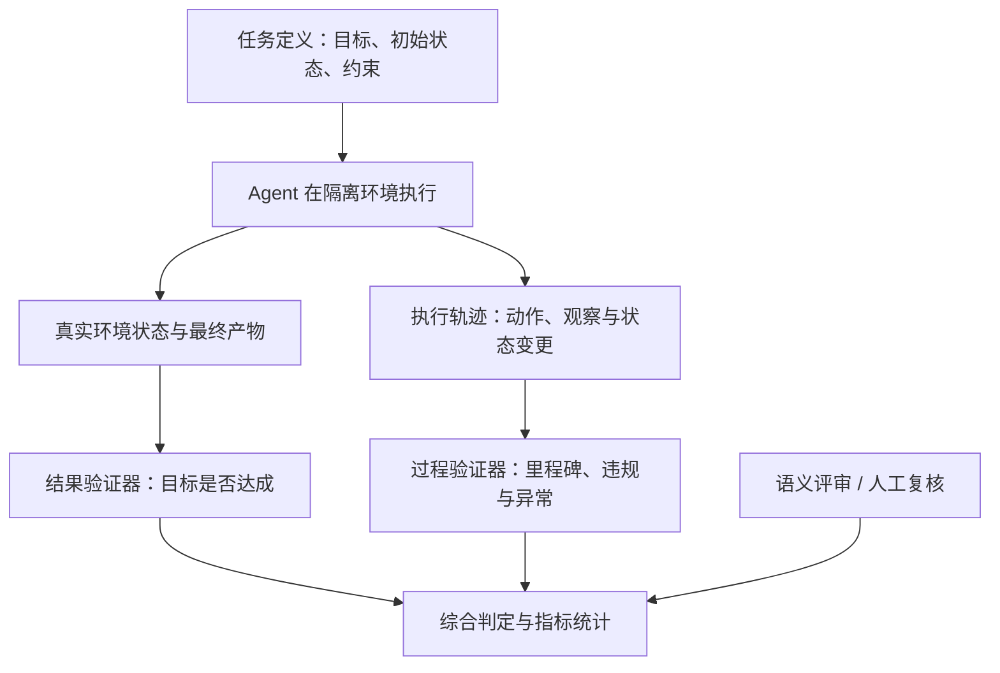

当一个 Agent 告诉我们“任务已经完成”时，应该相信它吗？

答案显然不能只取决于这句话。Agent 可能写出了正确的回复，却没有真正提交订单；可能在数据库中完成了目标修改，却顺手改动了无关记录；也可能最终产物合格，但过程中发生了越权访问或不可逆的错误操作。

因此，评价 Agent 时需要先区分两个问题：**Task Completion（任务是否完成）**，以及 **Agent Evaluation（完成得是否可靠、安全、高效）**。前者关注目标是否实现，后者还要检查执行路径、约束遵守、可重复性和成本。二者相关，却不能互相替代。

本文按照“判定方法—典型 Benchmark—过程评测—工程设计”的顺序，讨论如何建立可信的任务完成判定体系。

## 一、判断任务是否完成，有哪些方法？

从可观察证据来看，现有方法可以归纳为以下八类。

| 方法 | 主要证据 | 常见场景 | 主要局限 |
| --- | --- | --- | --- |
| 最终答案匹配 | 文本、结构化输出与参考答案 | 问答、信息检索、数据提取 | 可能无法确认外部操作是否发生 |
| 最终环境状态验证 | 数据库、文件、应用状态 | Browser Agent、CUA、工作流 | 可能漏掉已经恢复的错误操作 |
| 可执行测试 | 单元测试、集成测试、断言 | Coding Agent、Data Agent | 测试覆盖率和断言本身可能有缺陷 |
| 业务规则与约束验证 | 预算、权限、顺序、禁止动作 | 交易、规划、生产工作流 | 规则难以覆盖所有语义要求 |
| 执行轨迹评测 | 工具调用、返回结果、状态转移 | Tool-Using Agent | 容易把不同的有效路径误判为错误 |
| 中间里程碑验证 | 已实现的关键子目标 | 长程、多步骤任务 | 子目标定义和权重影响评价 |
| LLM-as-a-Judge | 评审模型对证据和质量的判断 | 报告、研究、开放式任务 | 可能存在偏差、幻觉及不稳定性 |
| 人工或用户验收 | 人类复核、实际可用性 | 复杂开放任务、高风险操作 | 成本高、主观差异大 |

这八类方法并非互斥。一个任务可以同时使用确定性的状态断言、过程日志分析和语义评审。更准确的说法是：**需要根据任务可验证的证据选择评测器，而不是为所有 Agent 强制采用统一的最终答案评分。**

例如，让 Agent 回答“论文发表于哪一年”，可以核对答案和可信来源；让 Agent 在网站创建项目，需要检查项目实际存在；让 Agent 编写软件补丁，则应运行测试；让 Agent 规划预算受限的旅行，除了检查行程文本，还要验证交通时刻和费用约束。

## 二、主流 Agent Benchmark 实际怎样做？

### 1. SWE-bench：通过可执行测试验证代码修改

[SWE-bench](https://www.swebench.com/) 要求模型或 Agent 根据真实 GitHub Issue 修改代码仓库。评测系统把生成的补丁应用到指定版本的仓库，在隔离环境中运行相应测试，以判断问题是否解决。

这种方式的优势是结果相对客观：评测器检查代码行为，而不依赖 Agent 自称“Bug 已经修复”。不过，**通过测试不等于绝对满足用户意图**。如果测试不完整，错误实现可能漏网；如果测试引入了 Issue 中未描述的额外要求，正确实现也可能被错误拒绝。

2026 年，OpenAI 对 SWE-bench Verified 的审查公开讨论了测试缺陷和数据污染风险。这提醒我们：验证器不是天然可靠的真值来源，它本身也需要审计。

### 2. WebArena：检查网页任务的功能正确性

[WebArena](https://webarena.dev/) 提供可复现的网站环境，面向网页交互任务评估 Agent 是否实现用户目标。对于查询型任务，可以比对答案；对于修改型任务，则需要检查页面或后台状态是否产生了预期变化。

这解决了一个常见误区：**按钮被点击，并不等于操作成功**。保存请求可能失败，表单可能不合法，权限也可能不足。可靠验证应检查提交后的真实状态。

### 3. OSWorld：执行完成后验证操作系统与软件状态

[OSWorld](https://os-world.github.io/) 让 Agent 操作真实桌面应用、文件和系统设置，并为任务提供可执行的评价机制。不同任务需要不同类型的检查：文件是否生成、配置是否变化、文档内容是否正确等。

它说明了桌面 Agent 评测的一个工程特点：验证器往往要深入到应用内部或文件系统，不能仅依赖截图和对话。

### 4. τ-bench：对比最终数据库状态并评估重复运行可靠性

[τ-bench](https://arxiv.org/abs/2406.12045) 模拟 Agent 与用户之间的多轮对话和工具操作，通过最终数据库状态与目标状态的对比判断任务结果，并提出 `pass^k` 衡量重复执行的一致成功能力。

这一设计区分了“偶尔能做对”和“多次都能做对”：真实系统通常同时需要正确性和稳定性。

上述案例展示了一个共同原则：**只要任务拥有可以独立检查的外部状态，就应该优先验证真实结果，而不是相信 Agent 最后的自然语言声明。**

## 三、为什么只检查最终结果还不够？

先看一个简单例子。用户要求 Agent 将订单 A 的配送方式改为指定快递，并且不得修改订单金额。

如果 Agent 最终把快递改对了，却也修改了金额，那么“目标字段正确”显然不足以判定任务成功。验证器需要同时检查目标条件和不允许发生的副作用。

更隐蔽的情形是：Agent 错误扣款后退款，最终账户余额恢复原状。只检查最后余额，可能把它与“从未错误扣款”的执行过程视为相同。但对于交易系统，两者的风险完全不同。

因此，至少要区分三类性质。

**终态性质（Final-state properties）**：任务结束时，目标是否成立。例如文件存在、记录已修改、测试已通过。

**轨迹性质（Trace properties）**：执行过程中是否出现禁止行为。例如泄露凭据、越权读写、重复付款、未经授权地提交外部请求。

**过程质量（Process quality）**：是否合理利用工具、是否发生无效循环、遇到失败能否恢复、是否在约束下高效地推进任务。这类性质更适合诊断 Agent 能力，未必应该直接参与二元完成判定。

特别需要注意：对一个成功任务，**不能因为 Agent 采用了与参考轨迹不同的有效路径就扣分**。过程评分应尽量关注可验证的状态转移、违规行为和有效进展，而不是硬编码某条“标准点击顺序”。

## 四、过程级评测正在解决什么问题？

### 1. 中间进展：失败不一定意味着没有价值

传统成功率把任务压缩成 0 或 1。假设两个 Agent 都未完成一个十步任务，其中一个已经完成九个关键子目标，另一个第一步就失败，二者的成功分数可能完全相同。

[Beyond Final Success: Semantic Progress Diagnostics for Agent Trajectory Evaluation（EMNLP 2026）](https://aclanthology.org/2026.emnlp-main.2140/) 研究了通过可验证的语义进展来分析执行轨迹，使任务的中间进展可被单独衡量。

可行的工程方法是把复杂任务分解为若干**可观察、可验证**的里程碑。例如，对于邮件处理任务，里程碑可以是“正确找到目标邮件”“提取必要信息”“生成符合要求的回复”“实际发送到指定收件人”。

里程碑必须建立在真实证据之上。若 Agent 仅在内部文字中说“已找到邮件”，但没有相应观察或工具结果，不能认定该步骤完成。

### 2. 关键错误定位：哪里开始失去成功机会？

[Where Did It Go Wrong? Process-Level Evaluation of Web Agents with Semantic State Tracking（2026）](https://arxiv.org/abs/2606.15673) 利用语义状态跟踪分析 Web Agent 的过程差异，并定位导致任务失败的关键节点。

这种方法回答的不只是“成功了吗”，还包括“究竟卡在搜索、筛选、提交还是验证阶段”。对于改进 Agent 的工具使用策略、规划和恢复能力，这类信息比单个成功率更有解释力。

### 3. 步骤有效性：每一步是否推动任务？

[AgentProcessBench（2026）](https://arxiv.org/abs/2603.14465) 关注工具增强 Agent 的步骤级过程质量。它提醒我们，判断一个动作是“有效探索”还是“无效操作”，并不总是容易的。

例如，Agent 为了确认页面状态而多刷新一次，未必是错误；但重复进行已知无法成功的操作，可能暴露出失败恢复能力不足。单纯以工具调用次数评判好坏，会惩罚必要的探索，因此需要把动作放在任务上下文中理解。

## 五、LLM-as-a-Judge 能不能直接判断是否完成？

可以辅助判断，但不应在缺少证据时替代状态验证。

LLM Judge 很适合处理语义性问题：研究报告是否覆盖要求、总结是否忠实于资料、行程安排是否符合自然语言偏好、生成内容是否易于使用。这些任务往往存在多个有效答案，很难用简单字符串匹配解决。

但如果任务是“已经把邮件发送出去”，给评审模型看一段漂亮的回复草稿，并不能证明邮件真的发出。此时需要收件地址、发送记录、API 回执或外部系统状态等证据。

即使是语义评分，也需要人工校准。一项 2026 年针对 LLM Judge 一致性与偏差的系统研究指出，高重复一致性并不能自动保证有效性；偏差仍可能存在。参考 [Reliability without Validity（2026）](https://arxiv.org/abs/2606.19544)。

实践上可以采用以下顺序：对可形式化目标使用程序验证；对开放式质量使用证据约束下的模型评审；对高风险或争议案例进行人工复核。评审结果应允许“证据不足”，避免被迫给出虚假的确定结论。

## 六、一个可落地的 Agent 评测架构

如果自行建设 Agent Benchmark，可以把任务定义、执行、结果验证和过程审计拆开：

*图：结果验证与过程验证并行工作，最后汇总成独立指标。*

在能够形式化的任务上，可以给出一个严格的完成判定定义：

$$
S_{\mathrm{success}}=\mathbb{I}\left[G(s_T)=1\land C(\tau)=1\right]
$$

其中，$s_T$ 是最终环境状态，$G(s_T)$ 表示所有必要的最终目标成立；$\tau$ 是完整执行轨迹，$C(\tau)$ 表示所有强制执行约束得到满足。这里的公式是一个**推荐的工程定义**，不是所有现有 Benchmark 已采用的统一标准。

如果一个任务具有难以形式化的语义要求，还需要把人工验收或经过校准的模型评审纳入目标判定，不能强行声称所有目标都可以写成布尔函数。

系统最好保留四种状态：**成功、部分完成、失败、证据不足**。这样可以避免在日志丢失、外部系统不可查询或验证器异常时，把无法确认的结果错误统计为成功。

此外，独立报告下列指标：

| 指标 | 建议含义 |
| --- | --- |
| Task Success Rate | 在严格定义下满足完整目标与硬约束的任务比例 |
| Goal Coverage | 可验证子目标的完成比例，用于诊断进展 |
| Constraint Violation Rate | 违反权限、预算、顺序和禁止操作等硬约束的比例 |
| Step / Process Quality | 关键动作有效性、错误恢复、无效循环等 |
| Reliability / pass^k | 重复运行能否持续成功 |
| Efficiency | 延迟、Token、工具调用次数和费用 |
| Judge Agreement | 自动评测与人工评审之间的一致程度 |

注意，**Goal Coverage 不能直接冲抵硬性违规**。对于一次未经授权的付款，即使其它九个步骤都成功，任务也不能因为“完成度 90%”而被判为安全成功。

## 七、验证器自身如何保证可靠？

一个经常被忽略的问题是：**Benchmark 的评分程序也会犯错**。不仅 Agent 可能幻觉，验证器也可能漏检、误判、被对抗性输入欺骗或依赖不稳定的环境。

因此，在正式使用前应该执行至少四类验证：用已知正确的参考解测试是否会被接受；用明显失败的样本测试是否会被拒绝；用“目标达成但发生副作用”的轨迹测试硬约束；用多种不同但有效的解决路径测试是否存在过度路径匹配。

对于使用 LLM Judge 的部分，应保留人工标注样本、评审准则和版本信息，测量一致性并审查分歧；对于工具执行的部分，应固定环境版本、日志结构和评分脚本，并将验证器与 Agent 的权限隔离。

此外，评测设计应关注数据污染及评测协议泄露。隐藏测试答案、隔离评分脚本、持续更新任务实例，可以降低通过记忆答案取得高分的风险。这与另一篇文章[《如何设计抗数据泄露的 Agent Benchmark》](/research/designing-contamination-resistant-agent-benchmarks/)讨论的问题直接相关。

## 八、结论：结果决定是否完成，过程解释为什么

判断 Agent 是否完成任务，最可靠的起点仍然是**验证实际结果**：查数据库、看文件、运行测试、核验外部回执。只有 Agent 自己宣称“完成”，通常不足以构成证据。

但最终状态也不是全部。对于具有约束、外部副作用和长执行轨迹的任务，还必须检查关键过程事件，避免“终态正确”掩盖越权操作、错误扣款和不可逆损失。

因此，我更倾向于把 Agent 的评测拆成两层：**一层是有硬约束的任务完成判定，另一层是对中间进展、错误归因、可靠性和成本的诊断**。这样既保留成功率的清晰含义，也能解释为什么某个 Agent 成功或失败。

未来特别值得研究的方向包括：从自然语言任务自动生成可验证的目标与约束；从长轨迹中识别真正的进展与关键错误；以及校准自动评测器，降低“错误评分比 Agent 本身错误更难发现”的风险。

## 参考资料

1. Anthropic. [Demystifying Evals for AI Agents](https://www.anthropic.com/research/demystifying-evals-for-ai-agents), 2026.
2. Jimenez et al. [SWE-bench: Can Language Models Resolve Real-World GitHub Issues?](https://www.swebench.com/), 2024.
3. Zhou et al. [WebArena: A Realistic Web Environment for Building Autonomous Agents](https://proceedings.iclr.cc/paper_files/paper/2024/hash/4410c0711e9154a7a2d26f9b3816d1ef-Abstract-Conference.html), ICLR 2024.
4. Xie et al. [OSWorld: Benchmarking Multimodal Agents for Open-Ended Tasks in Real Computer Environments](https://os-world.github.io/), NeurIPS 2024.
5. Yao et al. [τ-bench: A Benchmark for Tool-Agent-User Interaction in Real-World Domains](https://arxiv.org/abs/2406.12045), 2024.
6. [AgentProcessBench: Diagnosing Step-Level Process Quality in Tool-Using Agents](https://arxiv.org/abs/2603.14465), 2026.
7. [Beyond Final Success: Semantic Progress Diagnostics for Agent Trajectory Evaluation](https://aclanthology.org/2026.emnlp-main.2140/), EMNLP 2026.
8. [Where Did It Go Wrong? Process-Level Evaluation of Web Agents with Semantic State Tracking](https://arxiv.org/abs/2606.15673), 2026.
9. OpenAI. [Why We No Longer Evaluate SWE-bench Verified](https://openai.com/index/why-we-no-longer-evaluate-swe-bench-verified/), 2026.
10. [Reliability without Validity: A Systematic, Large-Scale Evaluation of LLM-as-a-Judge Models](https://arxiv.org/abs/2606.19544), 2026.
