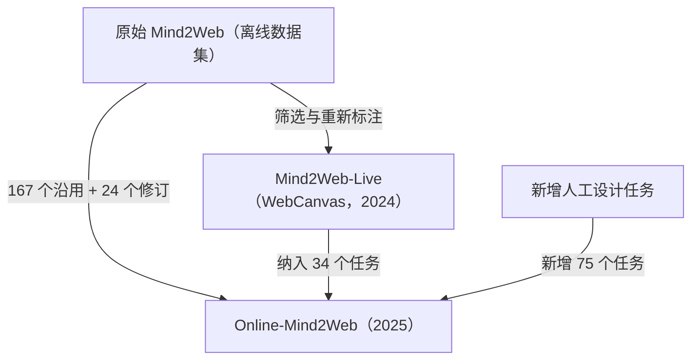
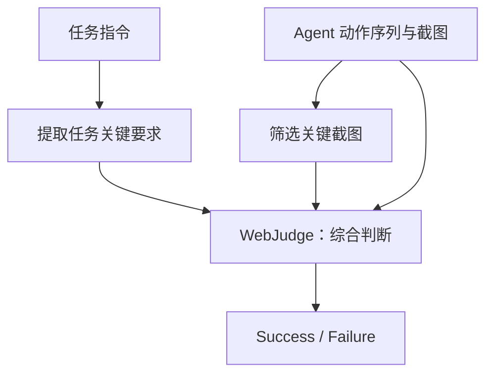

在评估 Browser Agent 时，经常会遇到 **Online-Mind2Web** 和 **Mind2Web-Live**。两者都让 Agent 在真实、持续变化的网站上执行任务，但它们并不是同一个 Benchmark 的新旧版本，而是由不同研究工作提出、具有一定数据继承关系的两套评测方案。

最关键的区别在于：**Mind2Web-Live 使用预先标注的关键节点检测任务进度和完成情况；Online-Mind2Web 主要结合执行轨迹、关键截图及任务要求，由人工或 WebJudge 判断整体任务结果。** 两者都报告 Task Success Rate，但“成功”的判定依据不同。

## 一、先看整体对比

| 维度 | Mind2Web-Live | Online-Mind2Web |
| --- | --- | --- |
| 代表工作 | WebCanvas（2024） | An Illusion of Progress?（2025，COLM 2025） |
| 评测环境 | 真实在线网站 | 真实在线网站 |
| 数据集规模 | 542 个任务：438 训练、104 测试 | 300 个任务，136 个网站 |
| 任务来源 | 从原始 Mind2Web 筛选、修订并重新标注 | 原始 Mind2Web、修订任务、部分 Mind2Web-Live 任务及新增任务 |
| 核心评测依据 | URL、页面元素、元素值等预定义关键节点 | 任务要求、动作轨迹、关键截图及人工或模型判断 |
| 主要指标 | Completion Rate、Task Success Rate、Efficiency Score | Task Success Rate |
| 适合分析 | 中间步骤进度、关键节点失败位置 | 端到端任务能否完成及跨网站表现 |
| 主要风险 | 关键节点随网站变化失效；预定义节点可能无法覆盖全部合法路径 | WebJudge 可能误判；轨迹和截图未必能证明所有真实状态变化 |

这里的“真实在线”意味着 Agent 要面对正在运行的网站，而不是只在保存的 HTML 上预测下一步点击。原始 Mind2Web 更偏向离线动作预测，不能直接与这两个在线 Benchmark 的任务成功率比较。

资料来源：[WebCanvas 论文](https://arxiv.org/abs/2406.12373)、[Online-Mind2Web 论文](https://arxiv.org/abs/2504.01382)。

## 二、两套数据集是什么关系？

Mind2Web-Live 由 WebCanvas 提出。研究者从原始 Mind2Web 中选取任务，针对真实网站重新检查可执行性，并为任务标注必经的关键节点。最终保留 542 个任务，包含 2,439 个关键节点和 4,550 个详细标注步骤。

Online-Mind2Web 则重新整理了一套 300 任务的数据集。其中有 167 个原始 Mind2Web 任务、24 个修订后的 Mind2Web 任务、34 个来自 Mind2Web-Live 的任务，以及 75 个新设计任务。因此，Online-Mind2Web 不是直接把 Mind2Web-Live 全部替换，也不是完全独立于旧数据。

*图：两套在线 Benchmark 与原始 Mind2Web 的数据来源关系。图中数字来自 Online-Mind2Web 论文的数据集构建说明。*

这种整理有现实原因：Online-Mind2Web 的作者抽样检查了原始 Mind2Web 的 650 个任务，发现约 47% 已无法执行，或者原有参考轨迹已经过时。真实网站的页面、内容及交互流程会不断改变，因此在线 Benchmark 必须维护任务有效性。

## 三、Mind2Web-Live 如何判断任务完成？

Mind2Web-Live 的核心是 **Key-node Evaluation（关键节点评测）**。

例如，用户要求在电影网站上找到符合条件的影片，研究者可以把任务拆成若干必要状态：进入指定页面、选择类型、应用排序条件、查看符合要求的结果。Agent 可以采用不同的点击路径，只要到达指定状态，就能通过相应的关键节点检查。

WebCanvas 主要利用 URL、元素路径和元素值等信息定义检查函数，并提供三类指标。

**Completion Rate** 衡量关键节点的完成程度，可以反映 Agent 做到了哪一步。

**Task Success Rate** 要求单个任务的全部指定关键节点都被成功验证。它同样是完整任务成功率，不能把它误解为只评估中间进度。

**Efficiency Score** 则根据任务执行动作数量与获得的关键节点得分，衡量执行效率。该指标的具体方向和定义应以原论文为准，不能简单理解为“越少点击越好”。

在 WebCanvas 原论文的实验中，最佳系统在 Mind2Web-Live 测试集上取得 **48.8% Completion Rate** 和 **23.1% Task Success Rate**。这是 2024 年论文的历史实验结果，不代表 2026 年的最新排行榜成绩。两个指标差距较大，说明 Agent 可以到达不少中间节点，却无法完成任务要求的全部节点。

这种方法的优势是诊断性强；局限是必须提前标注关键节点，而且网站变动可能导致检查函数失效。即便用户目标已经实现，若执行路径没有满足某些预定义节点，也可能被判定失败。

## 四、Online-Mind2Web 如何判断任务完成？

Online-Mind2Web 更关注 **端到端任务成功（End-to-end Task Success）**。它同样让 Agent 在真实网站操作，但评分主要基于人工评估或 WebJudge 自动评估。

WebJudge 是一种 LLM-as-a-Judge 方法，核心步骤包括：

1. 从任务指令中提取完成任务所需的关键要求（Key Point Identification）。
2. 从执行轨迹中筛选有代表性的截图，保留重要的操作证据（Key Screenshot Identification）。
3. 综合任务指令、关键要求、截图和动作序列，输出 Success 或 Failure（Outcome Judgment）。

*图：WebJudge 的评测逻辑简化示意。它使用部分关键截图，同时保留动作轨迹信息，并不只看最后一张截图。*

论文报告 WebJudge 与人工判断有约 85% 的一致率；官方仓库后续报告，以 o4-mini 为基础的版本约为 85.7%–86%。这意味着自动评分具有实用价值，但仍然可能误判。对于重要的正式排名，还应区分人工评估成绩与自动评分成绩。

截至 2026 年 11 月，Online-Mind2Web 已更新过部分失效任务，并在 2026 年引入 v2 轨迹提交格式。因此比较不同研究的成绩时，应核对任务版本、评估器版本与提交协议，而不能只看一个百分比。

## 五、一个例子：为什么两者可能给出不同结果？

假设用户要求：在某网站找到符合价格与配置要求的笔记本电脑，并提供指定信息。

对于 Mind2Web-Live，可以预先定义四个关键节点：到达商品列表、设置价格条件、设置内存条件、打开符合要求的商品页面。若 Agent 成功完成前三个节点，却未通过第四个节点的验证，它可能得到部分完成分数，但整体 Task Success Rate 对这个任务仍记为失败。

对于 Online-Mind2Web，评估器则会结合任务描述、实际操作和截图，判断 Agent 有没有完成用户要求的目标。它不需要依照同一组人工预定义的关键节点逐项打分。

需要注意，**两者的评分都不是直接读取网站后台 Ground Truth 的通用验证器**。关键节点检查可能遗漏合法路径；截图与轨迹判断也可能无法确认隐藏的数据库状态。若任务涉及实际修改、提交或支付，最好另外使用可验证的最终状态检查。

## 六、应该选哪个 Benchmark？

如果研究重点是 **Agent 的中间进度、失败位置、操作效率、关键节点奖励或过程级反馈**，Mind2Web-Live 更适合细粒度分析。它能够告诉我们任务中的哪些节点已经完成，而不只输出最终成败。

如果研究重点是 **Browser Agent 在不同真实网站上能否完成完整用户任务**，Online-Mind2Web 更适合做端到端能力比较。它具有更大的测试任务规模，并提供人工评估与自动评估的配套流程。

对于新的 Agent 评测系统，值得结合两者：**使用明确的最终任务成功标准作为主要指标，配合过程级关键节点或事件检查定位失败原因。** 对可以程序化验证的状态变更任务，还应进一步引入独立的最终状态验证器。

最后，无论采用哪套 Benchmark，都要记录执行时间、网站状态、浏览器环境、模型和 Agent 框架版本、动作预算与评估器设置。在线网站随时间变化，跨论文的成功率往往不能简单横向比较。

## 参考资料

1. Pan et al. (2024). [WebCanvas: Benchmarking Web Agents in Online Environments](https://arxiv.org/abs/2406.12373).
2. [WebCanvas 官方代码仓库](https://github.com/iMeanAI/WebCanvas).
3. Xue et al. (2025). [An Illusion of Progress? Assessing the Current State of Web Agents](https://arxiv.org/abs/2504.01382). COLM 2025.
4. [Online-Mind2Web 官方代码仓库与评测协议](https://github.com/OSU-NLP-Group/Online-Mind2Web).
5. [Online-Mind2Web 官方排行榜](https://huggingface.co/spaces/osunlp/Online_Mind2Web_Leaderboard).
